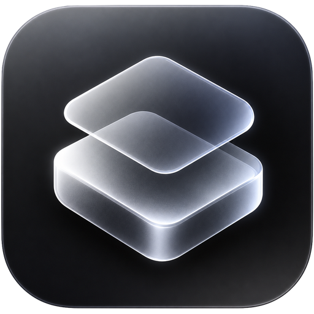

<p align="center"></p>

# Base

Your personal command center for tasks, calendar, projects, notes, habits, focus,
finances, news and the everyday lists you want to keep together.

Base's desktop interface is bundled locally with **Tauri 2, Rust, React 19,
TypeScript and Vite**. SQLite retains records and a durable queue of offline
edits. The browser client uses the same React pages with isolated IndexedDB
storage. Base Cloud runs on Cloudflare Workers, D1, R2, KV and Queues, with Clerk
sign-in and Stripe billing. There is no local Node.js server in the desktop app.

**Status: preview; not yet a general-availability release.**
[Open the Cloud preview](https://base-cloud-staging.kingbrownyplayz.workers.dev/app/)
or [see the website](https://base-cloud-staging.kingbrownyplayz.workers.dev/).
The current hosted instance uses Clerk Development and Stripe sandbox. The
legacy Next.js/Vercel application remains available as the migration rollback
path. Existing production data has not been automatically imported into Cloud.
See the [release checklist](docs/release-readiness.md) for verified checks,
remaining work and distribution limits.

## What is included

- **Dashboard:** arrange and resize widgets for tasks, calendar, projects, money,
  news and focus.
- **Tasks and calendar:** priorities, categories, subtasks, dates, recurring events
  and optional Cal.com bookings.
- **Projects and vision boards:** milestones, files, links, notes and an editable
  visual canvas.
- **Notes:** nested pages and folders, rich blocks, templates, links between
  notes, custom image/emoji icons, page locks, trash and HTML/plain-text copying.
- **Habits and streaks:** daily check-ins or numeric goals, activity history,
  timezone-aware streaks and archive/restore.
- **Finance and focus:** transactions, editable subscriptions, wallets, currency
  preferences, focus timer and session history.
- **News and markets:** configurable RSS/creator feeds, markets, summaries and
  personal integration keys where supported.
- **Shopping, reading and watch lists:** reusable custom-colour tags and tag
  filters; shopping also supports category and priority filters.
- **Workspace preferences:** onboarding, profile, themes, navigation order,
  command palette and keyboard shortcuts.
- **Workspace options:** a separate Rust/SQLite local service on Mac/Linux,
  connections to an existing service, or hosted Cloud workspaces. Local service
  lifecycle is independent of the desktop window.
- **Cloud sharing and billing:** owner-controlled Editable/Viewable membership,
  Plus entitlements, storage metering and sandbox-tested subscription flows.
  Production provider configuration and additional acceptance checks remain.
- **Integrations:** shared API adapters and OAuth-capable MCP. Integration parity
  for standalone local hosting remains in progress; see [Phase 2.5](docs/phase-2.5.md).

The existing native **SwiftUI/WidgetKit iPhone** client is retained. Its migration
into the new workspace/account system is the original Phase 3 and has not started.
The responsive browser UI is usable on phones today.

## Development

Install the patched Node version in [.node-version](.node-version) (currently
24.22.1), then install locked dependencies:

```bash
npm ci
```

For desktop development, install Rust and the
[Tauri platform prerequisites](https://v2.tauri.app/start/prerequisites/), then:

```bash
npm run desktop:dev
```

Build the desktop app and installers on the target platform:

```bash
npm run desktop:build
```

On Apple Silicon, open the built app with:

```bash
open apps/desktop/src-tauri/target/release/bundle/macos/Base.app
```

A local macOS build is ad-hoc signed. Public Developer ID signing/notarization
needs separate credentials. See [release readiness](docs/release-readiness.md)
and [Mac quickstart](docs/phase-2.5-mac-quickstart.md).

Run the new browser frontend against the configured hosted APIs:

```bash
npm run web:dev
```

Build its bundled assets, or run the local Cloudflare Worker:

```bash
npm run web:build
npm run cloud:dev
```

Cloud local development requires provider configuration and initialized local D1;
see [Cloud setup](docs/cloud-setup.md). `npm run dev` / `npm run build` refer to
**the legacy Next.js app**, not the new Vite browser client. `npm run ios` opens
the existing Xcode iPhone project; `npm run mac` opens the legacy WebKit Mac app.

## Checks

```bash
npm test
npm run typecheck
npm run desktop:typecheck
npm run web:typecheck
npm run cloud:check
npm run lint
cargo test --manifest-path native/BaseWorkspace/Cargo.toml
npm run workspace:bundle
cargo test --manifest-path apps/desktop/src-tauri/Cargo.toml
npm run desktop:build
```

Automated builds do not establish actual hardware, notification, clipboard,
updater or two-device offline/reconnection acceptance. The
[verification reports](docs/desktop-verification.md) state their limits.

## Repository layout

| Path | Purpose |
| --- | --- |
| `apps/desktop` | Locally bundled Tauri/Vite desktop client |
| `apps/web` | Vite browser workspace, landing page and public screenshots |
| `apps/cloud` | Cloudflare Worker, D1 migrations and service bindings |
| `packages/core`, `packages/sync` | Shared models, service configuration and sync contracts |
| `components`, `lib` | Shared React pages, UI, store and business logic |
| `native/BaseWorkspace` | Independent Rust/SQLite workspace server |
| `native/BaseCore`, `ios` | Existing SwiftUI models, offline client and WidgetKit |
| `app`, `macos` | Legacy Next.js backend/UI and Swift/WebKit Mac host |
| `docs` | Migration, setup, verification and release notes |

## Data and credentials

Unknown record fields, legacy Base/Bridge/Nexus keys and supported native
contracts are retained during migration. Workspace switching keeps scopes
separate; importing a copy is explicit. Never reset an existing database or
replace a credential-encryption key to repair connectivity.

Desktop sessions and supported personal integration secrets use OS credential
storage. Cloud credentials are server-side; browser sessions use HttpOnly
cookies. Never commit env files, keys, workspace exports or real-user screenshots.
The [Cloud setup guide](docs/cloud-setup.md) describes private configuration;
[security remediation](docs/security-remediation-2026-10.md) documents runtime
requirements and dependency backports. Git-triggered Vercel deployments are
disabled; publishing source must not redeploy the legacy service.

## Roadmap and releases

The original roadmap is unchanged:

1. Native desktop migration and offline-first architecture.
2. Desktop UI redesign and performance work.
3. Native SwiftUI iPhone modernization.

**Phase 2.5** adds local/managed workspaces, accounts, sharing, billing and the
Cloudflare migration between Phases 2 and 3. It is still in progress. Recent
fixes are documented in [Habits, tags and Notes](docs/habits-and-list-tags.md),
[Cloud record synchronization](docs/cloud-workspaces-016.md) and the
[release checklist](docs/release-readiness.md). No claim of completed production
migration, unlimited free-tier capacity or fully verified platform support is made.

Release preparation targets a source ZIP, Apple Silicon and Intel DMGs,
Windows EXE, and Linux AppImage/DEB. All required builds and acceptance gates
must pass before a draft becomes a public release. Updater signatures are
separate from Apple notarization and Windows Authenticode signatures.

To replace the landing screenshots with your own, follow
[landing-screenshots.md](docs/landing-screenshots.md). Use sanitized sample data.
